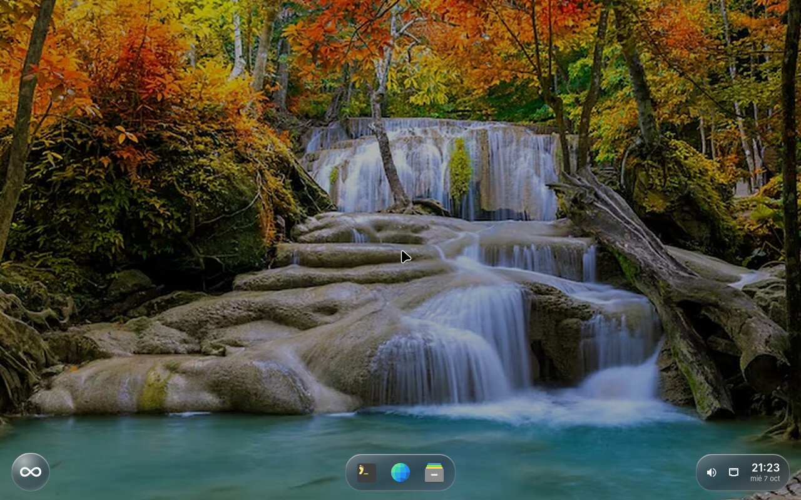
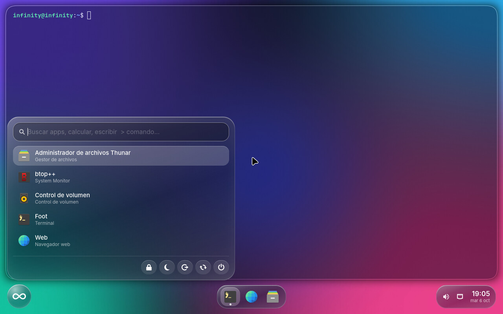
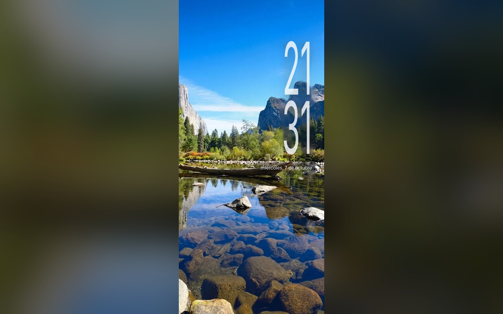
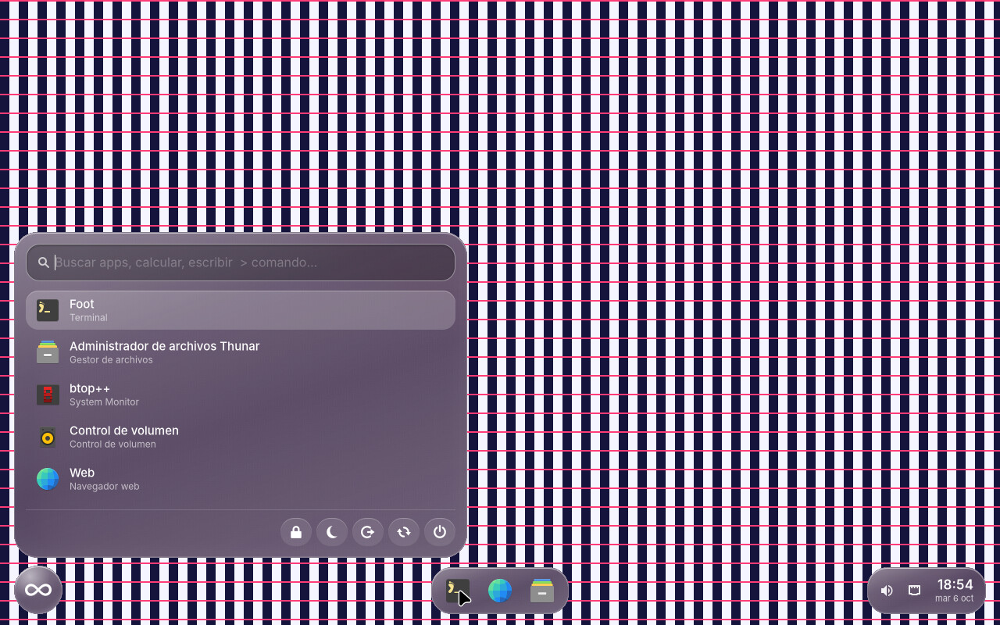

# Infinity OS ∞

Un sistema operativo **basado en Linux** (Ubuntu 26.04 LTS), minimalista y ligero, con interfaz de
**cristal líquido** ("liquid glass"): paneles translúcidos con el fondo desenfocado, brillo en los bordes
y un **logo ∞ flotante, separado de la barra de tareas**, desde el que buscas cualquier cosa y apagas el equipo.

<p align="center">
  
  
</p>
<p align="center"><sub>Capturas reales del sistema arrancado en una máquina virtual (QEMU, sin GPU).</sub></p>

| Lo que pediste | Cómo está resuelto |
|---|---|
| 1. Optimizado | Instalación mínima (sin snap ni servicios inútiles), swap comprimido en RAM, apagado rápido, un shell de un solo proceso con pocos temporizadores. ISO de **1,05 GB** (medida el 9 oct, antes de añadir Vulkan, Steam y los paquetes de juegos). [Detalles](#optimización) |
| 2. Minimalista + *liquid glass* | Compositor Hyprland (desenfoque real) + un shell propio con estilo de cristal. |
| 3. Logo separado de la barra, con búsqueda y apagado | El **orbe ∞** vive aparte, a la izquierda. Al pulsarlo (o con `Super + Espacio`) se abre un panel con buscador y botones de energía. |
| 4. Logo = tu imagen | Tu imagen, vectorizada (`branding/logo.svg`, error de trazado ≈ 1,5 %). |

---

## 1. Conseguir la ISO (desde Windows 10, sin instalar nada)

La ISO se construye **en la nube de GitHub**; tú solo la descargas.

1. Entra a este repositorio en GitHub → pestaña **Actions**.
   (Si no ves el flujo, asegúrate de que este código esté en la rama `main`.)
2. En la izquierda elige **Construir ISO de Infinity OS** → botón **Run workflow** → **Run workflow**.
3. Espera unos 10–25 minutos (círculo amarillo → check verde).
4. Abre la ejecución terminada y baja **infinity-os-iso** (sección *Artifacts*, abajo). Es un `.zip` con la ISO dentro.

> Para una versión "oficial" (la ISO queda en la pestaña **Releases**, sin zip): crea una etiqueta
> con la versión, por ejemplo `v0.1.0`.
>
> Si el repositorio es privado y los *Artifacts* te dan error de cuota, usa la vía de las etiquetas
> (las *Releases* no cuentan para esa cuota).

Comprueba que la descarga no se dañó: el archivo `.sha256` trae la huella. En PowerShell:
`Get-FileHash .\infinity-os-0.1.0-amd64.iso -Algorithm SHA256`.

## 2. Probarla en una máquina virtual (recomendado)

Probarla en una VM es lo más seguro: no toca tu Windows ni tus discos.

**VMware Workstation Player** (gratis para uso personal)
1. *Create a New Virtual Machine* → *Installer disc image file* → elige la ISO.
2. Sistema: **Linux → Ubuntu 64-bit**. Memoria: **4 GB**. Procesadores: **2 o más**.
3. Antes de iniciar: *Customize Hardware → Display → **Accelerate 3D graphics*** ✔.

**VirtualBox**
1. *Nueva* → Tipo **Linux**, versión **Ubuntu (64-bit)**. Memoria **4096 MB**, CPUs **2+**.
2. *Configuración → Pantalla*: controlador **VMSVGA**, memoria de vídeo **128 MB**, **Habilitar aceleración 3D** ✔.
3. *Almacenamiento*: inserta la ISO en la unidad óptica.

> Estas dos rutas son las recomendadas por cómo funcionan Hyprland y las VM, **pero no pude probarlas
> aquí** (todas mis pruebas fueron con QEMU). Si algo falla, usa "gráficos seguros" (abajo) y cuéntame qué pasó.

Al arrancar verás el menú de Infinity OS:

- **Infinity OS** — normal; **guarda tus cambios** si hay dónde (ver [Guardar tus cambios](#guardar-tus-cambios-al-apagar)).
- **sesión limpia** — igual, pero sin leer ni escribir el guardado (si un cambio guardado estropeó algo).
- **gráficos seguros** — úsalo si la pantalla sale negra o el escritorio no aparece (típico en VM sin 3D).
  Desactiva desenfoque y animaciones y renderiza por software.
- **gráficos seguros (nomodeset)** — último recurso.
- **diagnóstico** — muestra los mensajes del arranque.

El sistema **se recupera solo** de fallos: si Hyprland se cae nada más arrancar, reintenta en modo seguro; si se
cae con la sesión iniciada, vuelve al escritorio (hasta 3 veces). El registro queda en
`~/.local/state/infinity/sesion.log`.

En modo en vivo el usuario es `infinity`, **sin contraseña** (en la pantalla de bloqueo basta pulsar Enter) y con
`sudo` sin contraseña.

### Guardar tus cambios al apagar

Una ISO «en vivo» olvida todo al apagar. Infinity OS arranca con `persistent`: si hay un sitio donde guardar, **tu
HOME, los ajustes, pAnkI y su calendario, las redes wifi y lo que instales sobreviven al apagado**.

- **En un USB (equipo real):** grábalo con Rufus en modo **Imagen DD** (o con balenaEtcher) en un pendrive **más
  grande que la ISO**. La primera vez que arranques, el sistema crea solo, en el espacio libre del USB, una partición
  `writable` (necesita al menos 100 MiB libres) y desde entonces guarda ahí. No hay que hacer nada más.
- **En una máquina virtual con la ISO como CD:** el CD no se puede escribir, así que añade un **segundo disco
  virtual vacío** (4 GB bastan) y, una sola vez, en una terminal de Infinity OS: `lsblk` (para ver cuál es el
  disco vacío; suele ser `sdb`) y `sudo mkfs.ext4 -L writable /dev/sdb`. Al reiniciar lo usa solo.
- **Saber si se está guardando:** *Ajustes → Sistema → Guardado de cambios* lo dice.
- **Ojo al actualizar la ISO:** el guardado conserva tu HOME antiguo y *tapa* los archivos de configuración que
  traiga la ISO nueva. Si algo nuevo no aparece, arranca con **sesión limpia** o borra el guardado
  (`sudo mkfs.ext4 -L writable /dev/sdXN` sobre esa partición; **borra todo lo guardado**).

Para llevarla a un equipo real (no VM): grábala en un USB con [Rufus](https://rufus.ie) en modo
**"Imagen DD"** o con [Ventoy](https://www.ventoy.net). Ojo: **aún no tiene instalador** (ver
[Estado](#estado-y-limitaciones)) y no arranca con *Secure Boot* activado.

## 3. Usarla

| Atajo | Acción |
|---|---|
| `Super + Espacio` o clic en el **orbe ∞** | Buscador (apps, calculadora, `> comando`, `? pregunta` para pAnkI, web) + apagar/reiniciar |
| `Super + Enter` | Terminal (cristal translúcido) |
| `Super + E` / `Super + B` | Archivos / Navegador |
| `Super + Q` | Cerrar ventana |
| `Super + F` / `Super + V` | Pantalla completa / ventana flotante |
| `Super + M` / `Super + Shift + F` | Minimizar la ventana (se recupera desde el dock) / maximizar y restaurar |
| `Super + ←↑↓→` | Mover el foco · con `Shift`, mover la ventana |
| `Super + 1…5` | Escritorios · con `Shift`, enviar ventana |
| `Super + L` | Bloquear la pantalla: hora gigante a la derecha (también se bloquea sola a los 10 min) |
| `Super + ,` | **Ajustes** del sistema (ver abajo) |
| `Super + N` o la **burbuja** del borde derecho | **pAnkI**, el agente virtual (ver abajo) |
| `Impr` / `Shift + Impr` | Captura de región al portapapeles / pantalla completa a `~/Imágenes` |
| `Super` + arrastrar (izq./der.) | Mover / redimensionar ventana |

> `Super` es la tecla con el logo de Windows.

### Ajustes del sistema

`Super + ,`, el engranaje del buscador (orbe ∞, junto a los botones de energía) o **Ajustes** en el menú de
aplicaciones abren la app de configuración. Sus páginas:

- **Escritorio:** fondo (galería de imágenes, las tuyas o un color sólido), color, marca ∞, escala de pantalla, efecto cristal
  (desenfoque, calidad, opacidad de los paneles), separación, esquinas, sombras y animaciones.
- **Dock y estado:** formato de la hora (24 h / 12 h) y segundos para confirmar apagar o reiniciar.
- **Bloqueo y energía:** fondo de la pantalla de bloqueo (misma galería); tiempos para bloquear, apagar la pantalla y suspender; bloquear antes de dormir;
  formato de la hora y tiempo de la contraseña en la pantalla de bloqueo.
- **Teclado y ratón:** distribución, velocidad del ratón y gestos del táctil.
- **Terminal:** fuente, tamaño y transparencia.
- **Atajos:** los atajos de `hyprland.conf`, solo para consultar (se cambian editando ese fichero).
- **Sistema:** datos del equipo y los comandos de administrador para la zona horaria, el idioma y el teclado
  de la consola (esos ajustes necesitan permisos de administrador y no están en la app).

Pulsa **Aplicar**: Hyprland, hypridle, el fondo y el shell se recargan al momento. Los cambios de la **terminal**
y de la **pantalla de bloqueo** se ven en las ventanas que abras después. **Restaurar** carga los valores de
fábrica (todavía sin aplicar); **Exportar…** e **Importar…** guardan y cargan los ajustes en un fichero JSON.

**Fondos de pantalla:** en **Escritorio** y en **Bloqueo y energía** eliges la imagen en una galería de miniaturas
(el escritorio se cambia al pulsar Aplicar; el bloqueo, la próxima vez que se bloquee). Para usar la tuya,
**Añadir imagen…** (se abre en Descargas; también vale arrastrar un archivo): desde el navegador, clic derecho
sobre la imagen → «Guardar imagen como…». Acepta JPG, PNG y WebP (hasta 40 MB), se guarda recortada para cada
resolución en `~/.local/share/infinity/fondos/` y **Quitar** la borra. El catálogo del sistema está en
`branding/fondos/` (se instala en `/usr/share/infinity/fondos/`). Si el fondo elegido falta o está dañado, se usa
el de siempre (y, sin ninguna imagen, el bloqueo se pone igual, sin foto).

Los valores se guardan en `~/.config/infinity/ajustes.json`. La app genera `hypr/infinity-ajustes.conf`,
`hypr/hypridle.conf` e `infinity/estilo.css` (no los edites a mano: se reescriben), y cambia solo las claves
que gestiona de `foot/foot.ini` y `gtklock/config.ini`, dejando el resto del fichero como esté.

> **En la ISO en vivo, los cambios se pierden al apagar.** Antes de apagar, usa **Exportar…** y guarda el
> fichero en un USB; después, **Importar…** lo carga en la sesión nueva.

**Buscador del orbe:** escribe para filtrar apps (sin importar tildes ni mayúsculas, acepta letras
sueltas: `ffx` → Firefox). `2+2*10` calcula; `> ls -la` ejecuta en una terminal; cualquier otra cosa se
busca en la web. Apagar, reiniciar y cerrar sesión **piden confirmación** (pulsa dos veces; también puedes
escribir "apagar" y pulsar Enter dos veces) para no apagar por accidente.
**Dock:** clic = abrir o ir a la ventana · clic central = ventana nueva · clic derecho = abrir ventana
nueva, cerrar, fijar/quitar del dock.
**Controles de ventana:** junto a cada ventana, encima de su esquina superior derecha (dentro de ella si encima no cabe), una pastilla de cristal con **−** (minimizar), **□** (maximizar / restaurar) y **×** (cerrar); la dibuja el shell porque Hyprland no tiene barras de título. Una ventana minimizada sigue en el dock: un clic en su icono la trae de vuelta. Detalles y límites en [`docs/controles-ventana.md`](docs/controles-ventana.md).

<p align="center"></p>

**Pantalla de bloqueo:** al bloquear (botón del orbe, `Super + L` o por inactividad) la foto de paisaje ocupa toda la pantalla y la **hora en directo** va arriba a la derecha, en dos líneas, gigante, con la fecha debajo. Toca una tecla o mueve el ratón para que aparezca la contraseña (se vuelve a esconder sola); en el modo en vivo no hay contraseña, basta pulsar Enter. La foto se recorta al centro para llenar cualquier resolución (`branding/make_assets.py` genera un fondo por cada una), y la posición de la hora se calcula con el tamaño real de la pantalla que lee Hyprland. La hora se dibuja en directo con la fuente *Infinity Reloj* (`branding/make_fonts.py`), que es Inter comprimida en horizontal, así que la foto no lleva texto. Para cambiar el formato de la hora, **Ajustes → Bloqueo y energía** (en dos líneas o en una, 24 o 12 horas).

**Si el ratón va con lag (VirtualBox u otra VM):** en una VM sin aceleración 3D todo se dibuja por CPU. No hay una medida reproducible de cuánto cuesta cada fondo, así que lo siguiente son recomendaciones y no datos.

Si va lento, cambia el fondo a **Color sólido** en **Ajustes → Escritorio** y pulsa Aplicar (no hace falta cerrar
sesión). Para volver a la cascada, elige **Cascada** y vuelve a pulsar Aplicar. Usa la app y no edites
`~/.config/infinity/fondo` a mano: la app también reinicia el fondo y la marca.

Con el color, el desenfoque (cristal) de los paneles sigue activo; si aun así va lento, desactívalo en
**Ajustes → Escritorio → Efecto cristal**. No he medido cuánto ayuda cada cosa por separado.

Ajustes en VirtualBox que ayudan (no pude probar VirtualBox, así que son recomendaciones):
1. **Configuración → Sistema → Placa base → Dispositivo señalador: *USB Tablet*** (puntero absoluto, sin
   "capturar" el ratón). Es el ajuste que más suele notarse.
2. **Pantalla:** controlador *VMSVGA*, memoria de vídeo al máximo (128 MB) y **Habilitar aceleración 3D** ✔.
   Con 3D sin soporte real del host, el escritorio sigue dibujándose por CPU.
3. **Sistema:** 4 CPU y 6–8 GB de RAM (tu equipo tiene 16 GB). Un monitor virtual de 1280×720 o 1366×768
   cuesta menos por fotograma que uno de 1920×1080.
4. Si el equipo tiene Hyper-V o "Seguridad basada en virtualización" activados en Windows, VirtualBox funciona
   en un modo más lento; desactivarlo es una decisión tuya, con sus consecuencias.

Para saber qué renderizador usa el escritorio, en una terminal (`Super + Enter`):
`grep -m1 Renderer /run/user/$(id -u)/hypr/*/hyprland.log`. Si dice `llvmpipe`, es renderizado por CPU.

Viene configurado para **Chile**: idioma `es_CL`, teclado **Latinoamérica** (el teclado chileno estándar) y
zona horaria de **Santiago** (con cambio de horario de verano). Para otro país edita
[`build/config.env`](build/config.env) y vuelve a construir.

### pAnkI, el agente virtual

pAnkI es un asistente local de **tareas, agenda y notas**, con un chat por reglas en español (sin
modelo de lenguaje: entiende fechas, horas y categorías escritas en lenguaje natural) y, en su «Modo
Profundo», consultas puntuales a un puñado de APIs públicas gratuitas para preguntas generales de la
vida diaria (clima, divisas, traducción...). Vive en una **burbuja de cristal** en el borde derecho de
la pantalla (hermana del logo ∞), y se abre también con `Super + N`, escribiendo `? tu pregunta` en el
buscador o desde el menú de aplicaciones.

**No necesita clave ni cuenta.** Es una app web de un solo archivo que corre entera en tu navegador
(alojada en una ventana con WebKitGTK); sus datos (tareas, notas, agenda) viven en el almacenamiento de
esa ventana, no se suben a ningún servidor propio, y sobreviven a cerrarla y volver a abrirla.

**Qué puede hacer** (y qué ya NO hace, a diferencia de versiones anteriores):

- Tareas, agenda y notas: crearlas, completarlas, borrarlas, exportarlas e importarlas como respaldo.
- Entender fechas, horas y duraciones en español natural ("mañana a las 10", "en media hora").
- Un temporizador, una calculadora y un resumen de tu día, dentro del propio chat.
- En **Modo Profundo**, preguntas generales (clima, divisas, traducciones, definiciones, países,
  cripto...), consultando solo el tema de la pregunta a una lista cerrada de servicios públicos
  gratuitos; en **Modo Rápido** no sale nada de tu equipo.
- Cambiar su nombre (por defecto «pAnkI»), desde Ajustes (*pAnkI (IA)*) o pidiéndoselo por el chat
  ("llámate Nova").
- Ya **no** lee, mueve ni organiza archivos; no abre apps ni páginas web; no cambia ajustes del
  sistema; no ejecuta comandos. No hay tarjetas de permiso porque no hay nada que pedir permiso para
  hacer: no toca el sistema.

**Lo que no está probado:** WebKitGTK 6.0 real (el entorno donde se escribió esto no tiene el paquete
de introspección instalado; solo se comprobó, con GTK real, que la ventana se degrada con un aviso en
vez de no abrir si llegara a faltar), la posición de la ventana en una sesión real de Hyprland (solo
contra la configuración como texto) y que sus datos sobrevivan de verdad a un reinicio del equipo.
Detalles de diseño en [`docs/panki-web-diseno.md`](docs/panki-web-diseno.md) (el motor anterior, con
Gemini, está en [`docs/panki-diseno.md`](docs/panki-diseno.md)).

## Optimización

Qué se hizo para que sea ligera, y por qué:

- **Base mínima:** `debootstrap --variant=minbase` e instalación **sin "recomendados"**. El sistema es *exactamente*
  lo que dice [`build/packages.list`](build/packages.list), nada más. Sin `snap` (bloqueado a propósito: es lento
  de arrancar y gasta RAM), sin `cloud-init`, sin indexadores ni servicios de GNOME/KDE.
- **Sin pantalla de inicio de sesión pesada:** `greetd` + `tuigreet` en lugar de GDM/SDDM.
- **Compresión de arranque rápida:** el sistema va en `squashfs` con **zstd** (descomprime mucho más rápido
  que xz) y el initramfs también en zstd.
- **Menos peso muerto:** sin documentación ni traducciones que no uses (solo español/inglés), sin el firmware de
  servidores y móviles ARM (Mellanox, Qualcomm…), solo los controladores Vulkan que piden los juegos (de 32 y 64 bits; Hyprland no los necesita)
  y con un solo tema de cursor.
- **Memoria:** swap **comprimido en RAM (zram + zstd)**, `earlyoom` (evita que el equipo se cuelgue al llenarse
  la RAM, protegiendo el escritorio) y ajustes de `sysctl` pensados para zram.
- **Arranque y apagado:** se enmascaran los temporizadores de apt, `man-db` y las esperas de red; los servicios
  que no responden se cortan a los **10 s** en lugar de 90 s; sin la pregunta de "quita el medio de instalación".
- **Disco:** planificador de E/S según el tipo de disco (NVMe `none`, SSD `mq-deadline`, HDD `bfq`) y `fstrim`
  semanal. Registro del sistema solo en RAM y limitado a 64 MB.
- **Escritorio:** Hyprland con `vfr` (solo redibuja cuando algo cambia). El shell (dock, orbe, buscador) es
  **un solo proceso**: se entera de las ventanas por el socket de Hyprland y de la red por señales del sistema.
  Tiene pocos temporizadores: el reloj se alinea al minuto y cada 30 s se actualizan batería, volumen y red. El
  dock solo se redibuja si algo visible cambió, y las consultas a Hyprland van en un hilo aparte para que la interfaz
  nunca se congele. Los atajos hablan
  con el shell por D-Bus (`gapplication`), sin arrancar Python. El buscador se crea la primera vez que lo abres.

### Mediciones

Solo lo medido, con método y fecha:

| Qué | Resultado | Método y fecha |
|---|---|---|
| Tamaño de la ISO | **1,05 GB** (1 049 399 296 bytes) | `ls -l` de la ISO tras `build/build.sh`, 9 oct 2026, **antes de añadir Vulkan, Steam y los paquetes de juegos** (no mide la versión actual). La construcción del 8 oct dio 1,09 GB (1 091 817 472 bytes). |
| `squashfs` del sistema | 0,95 GB (949 383 168 bytes) | `casper/filesystem.squashfs` de la misma construcción (9 oct 2026), con el mismo límite |
| Construcción desde cero | 5 min 18 s | diferencia entre la hora de inicio y la de fin de `build/build.sh`, 7 oct 2026 |
| Swap | zram de tamaño `ram / 2` con zstd; `swappiness` 133 | configuración en `overlay/etc/systemd/zram-generator.conf` y `overlay/etc/sysctl.d/99-infinity.conf`; no medido en ejecución |

El tiempo de arranque no es significativo aquí: QEMU emula la CPU sin aceleración (≈ 2 min hasta poder iniciar
sesión). En un equipo real será mucho menor, pero **no lo medí**. Tampoco medí consumo de CPU/batería en reposo.

### Modo juego

La app **Juegos** (o `infinity-juegos` en una terminal) prepara el equipo para jugar. Con `sudo`:

- `activar`: governor `performance` en todos los núcleos (guarda el original).
- `liberar-ram`: libera la caché de páginas limpias, con `sync` antes.
- `optimizar PID`: nice −10 en todos los hilos del proceso; con `--tiempo-real`, además SCHED_RR en el hilo principal.
- `revertir`: devuelve el governor, el nice y la política guardados.

Medido el 9 de octubre de 2026 en un equipo de pruebas de 4 núcleos sin control de frecuencia:

- **Planificación:** `optimizar` cambió el nice (0 → −10) y la política (SCHED_RR) del proceso de prueba. Su reparto
  de CPU frente a 4 procesos de carga pasó de 64,5 % a 94,7 %. En esa medida solo cambió el hilo principal; desde
  entonces no se han medido de nuevo los hilos secundarios.
- **Liberar caché:** `liberar-ram` quitó unos 512 MB de caché, pero la memoria disponible no subió (mediana +24 MB en
  10 repeticiones). La siguiente lectura de un fichero de 512 MB tardó de mediana 0,185 s, frente a 0,070 s con la
  caché caliente.

**No está demostrado:** que suba los FPS o la fluidez de ningún juego (no se ha medido); que el governor
`performance` aporte algo (el equipo de pruebas no tenía control de frecuencia para medirlo); ni que liberar la
caché ayude.

## Cómo funciona (para curiosos)

```
GRUB (BIOS o UEFI) → kernel Linux → casper (monta la ISO y crea el usuario) → systemd
   → greetd (inicia sesión solo) → infinity-session → Hyprland (compositor)
        ├─ swaybg ........... el fondo de pantalla: la cascada (con el fondo de color no se lanza: lo pinta Hyprland)
        ├─ infinity-shell ... orbe ∞ + dock + estado (3 ventanas "capa") + buscador (oculto hasta que lo abres)
        └─ infinity-ajustes . la app de Ajustes: escribe ~/.config/infinity/ajustes.json y los ficheros de cada
                              programa, y pide a Hyprland, hypridle, el fondo y el shell que se recarguen
```

**El efecto cristal** son dos mitades que se complementan:
1. **Hyprland desenfoca lo que hay detrás** de las piezas del shell. Las reglas `layerrule` de `hyprland.conf` lo
   activan para todo lo que se llame `infinity-*`, y `ignore_alpha` evita desenfocar las esquinas transparentes.
2. **El CSS del shell dibuja el vidrio** (`style.css`): relleno translúcido, un reflejo diagonal, un borde de luz
   y un brillo especular en el canto superior.

<p align="center">
  
  <br><sub>Prueba del desenfoque: con un fondo de rayas nítidas, detrás de cada panel de cristal las rayas desaparecen.</sub>
</p>

**Por qué el orbe está "separado":** cada pieza (orbe, dock, estado) es su propia ventana de tipo *layer-shell*,
anclada a un lugar de la pantalla. No hay una barra que las contenga: el orbe flota solo, justo como pediste.

## Estructura del repositorio

```
build/            construcción de la ISO
  build.sh          script principal (debootstrap → squashfs → ISO híbrida BIOS+UEFI)
  chroot-setup.sh   lo que se ejecuta dentro del sistema en construcción
  packages.list     ← los paquetes del sistema (edítalo)
  config.env        ← idioma, teclado, zona horaria, nombre (edítalo)
  grub.cfg          menú de arranque
overlay/          archivos que se copian tal cual al sistema (/etc, /usr…)
  etc/skel/.config/hypr/hyprland.conf   ← el aspecto "cristal" y los atajos
overlay-pre/      configuración de apt/dpkg que debe existir ANTES de instalar paquetes
shell/            el shell propio: orbe, dock, estado, buscador y pAnkI (Python + GTK4)
  infinity_shell/style.css              ← el estilo de cristal de las piezas
  tests/                                 pruebas automáticas (incluye un Hyprland simulado)
branding/         logo (SVG), fotos de referencia, fondos, fuente de la hora e imagen del menú de arranque
docs/             capturas, diseño de pAnkI e informe de revisión
.github/workflows/build-iso.yml   construye la ISO en GitHub
```

## Personalizar

| Quiero… | Edito… |
|---|---|
| Cambiar idioma, teclado, zona horaria | `build/config.env` |
| Añadir o quitar programas | `build/packages.list` |
| Colores, desenfoque, animaciones, escala, teclado, bloqueo, terminal, hora | **Ajustes** (`Super + ,`) |
| Atajos de teclado | `overlay/etc/skel/.config/hypr/hyprland.conf` |
| Añadir un ajuste nuevo | `shell/infinity_shell/ajustes.py`: una entrada en `SCHEMA` (la ventana crea el control sola) y, si toca un fichero, una línea en `generar()` |
| Cambiar el aspecto de dock/orbe/buscador | `shell/infinity_shell/style.css` |
| Apps fijadas en el dock | `overlay/etc/infinity/fijados` (o clic derecho en el dock) |
| Fondo de pantalla | `branding/make_assets.py` (genera `wallpaper.jpg`) |
| Cambiar el nombre del sistema | `OS_NAME` en `build/config.env` |

Después de cambiar algo, sube los cambios a GitHub y vuelve a ejecutar el workflow
(también se ejecuta solo al subir cambios a `main`).

**Construir en tu propio Linux** (opcional): `sudo apt install debootstrap squashfs-tools xorriso mtools grub-pc-bin grub-efi-amd64-bin rsync`
y luego `sudo ./build/build.sh`. La ISO queda en `out/`.

## Estado y limitaciones

Esto es la **versión 0.1**: una ISO "en vivo" (arranca sin instalar). Lo que cambies **se guarda al apagar** solo si
hay una partición de guardado (ver [Guardar tus cambios](#guardar-tus-cambios-al-apagar)); si no, se pierde.

**Verificado** (construyendo la ISO desde cero y arrancándola en QEMU, controlada desde fuera):
- Arranque completo por **BIOS**: GRUB → kernel → casper (crea el usuario) → `greetd` → Hyprland → shell.
- Arranque por **UEFI** (firmware OVMF): menú de GRUB con la marca, kernel y sesión gráfica (Hyprland y shell
  iniciados). No llegué a ver el dock dibujado en esa prueba concreta por la lentitud de la emulación.
- **Orbe ∞** (clic y `Super + Espacio`), **dock** (clic, clic central, clic derecho), **estado** (reloj, red) y
  lanzamiento de la terminal y del navegador.
- **Apagado desde la interfaz**: clic en el orbe → botón de apagar → *"Apagar: pulsa otra vez para confirmar"* →
  segundo clic → el sistema se apaga.
- **App de Ajustes** en la VM, con su ventana real: aplicar escala, cristal, fondo y marca, reloj de 12 horas,
  bloqueo, terminal y teclado (Hyprland, hypridle, foot y gtklock lo reciben); un valor no válido no escribe nada;
  restaurar, exportar e importar; y el atajo `Super + ,`. Además, `shell/tests/test_ajustes.py` comprueba la
  validación y que los ficheros del skel coinciden con lo que genera la app.
- **Desenfoque** del fondo detrás de los paneles (prueba de las rayas, arriba), bloqueo/desbloqueo de pantalla,
  red por cable conectada, recuperación automática tras forzar una caída de Hyprland.
- Pruebas automáticas del shell (búsqueda, calculadora, comunicación con Hyprland) y validación de las
  configuraciones con las herramientas de cada programa (`Hyprland --verify-config`, `foot --check-config`,
  `udevadm verify`).

**No verificado / límites conocidos:**
- **Nunca se ejecutó en una GPU real.** Todo el renderizado fue por software; el aspecto exacto del cristal con
  GPU puede necesitar ajustes (`size`, `passes`, `vibrancy` en `hyprland.conf`).
- **VMware, VirtualBox y hardware real:** sin probar. El flujo de **GitHub Actions** usa el mismo script de
  construcción que sí se probó, pero aún no se ha ejecutado en GitHub.
- Sin probar: audio, teclas de brillo/volumen, capturas de pantalla (`Impr`), WiFi, varios monitores, pantallas HiDPI.
- La app de Ajustes no cubre todavía audio, red ni Bluetooth, ni cambiar los atajos o el idioma/zona horaria del
  sistema (esos últimos se explican en la página *Sistema*). La página *Sistema* solo muestra datos.
- Durante las pruebas hubo **una caída aislada de Hyprland** (en el renderizador por software `llvmpipe`) mientras
  la VM emulaba una CPU exótica; no se repitió con una CPU estándar en más de 9 minutos de uso intensivo.
- **Sin instalador a disco** todavía. **Sin Secure Boot** (desactívalo en la BIOS/UEFI o usa una VM).
- La red WiFi se elige con `nmtui` (clic en el icono de red del panel de estado): aún no hay un selector gráfico.
- No es *exactamente* el "Liquid Glass" de Apple: un compositor normal no puede refractar la luz, así que se
  aproxima con desenfoque + translucidez + reflejo especular en el borde.

## Hoja de ruta

1. Instalador a disco (Calamares).
2. Panel rápido (WiFi, Bluetooth, brillo, volumen) y centro de notificaciones.
3. Pantalla de arranque (Plymouth) con el logo ∞ animado.
4. Ajustes de red, Bluetooth y audio en la app de Ajustes; tema de iconos propio.
5. Soporte de Secure Boot y Flatpak.
